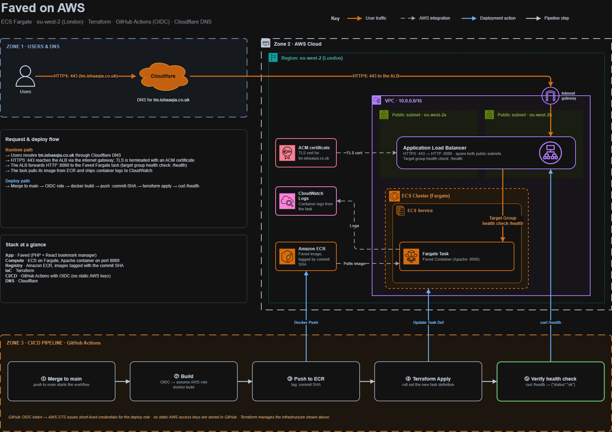
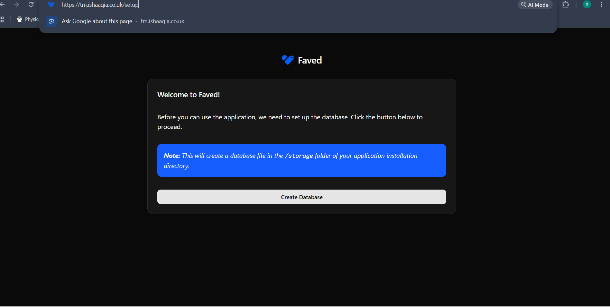
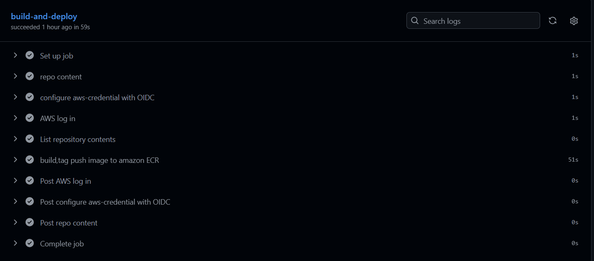
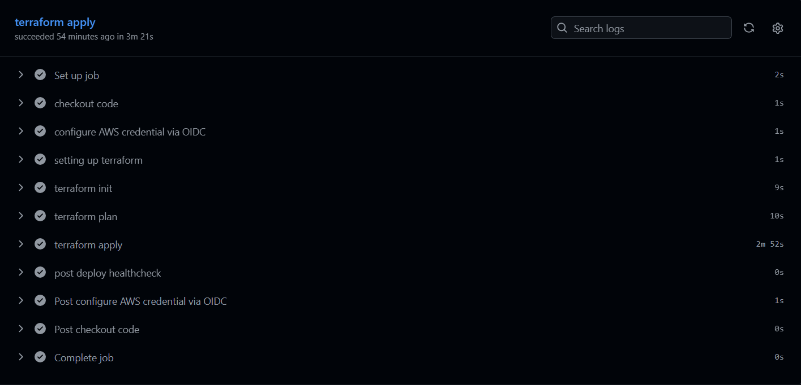
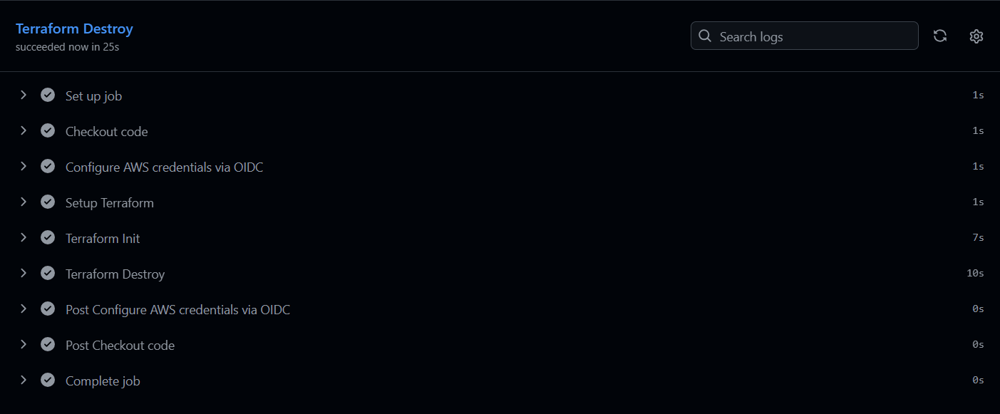

# Faved on AWS: End-to-End CI/CD Deployment

## Architecture Overview



This project deploys the open-source bookmark manager **Faved** to AWS using a fully automated, containerised, and Infrastructure-as-Code (IaC) approach.

The infrastructure is managed by Terraform and consists of two distinct scopes:

1. **The Bootstrap Scope (`/terraform/bootstrap`)**: Manages the GitHub Actions OIDC provider and IAM roles. This is kept separate so the CI/CD pipeline never destroys its own permissions.

2. **The Application Scope (`/terraform/infra`)**: Manages the networking and compute resources.

**Traffic Flow:**

Users resolve the custom domain via Cloudflare DNS, which points to an **Application Load Balancer (ALB)**. The ALB terminates HTTPS using an **ACM Certificate** and forwards HTTP traffic to a **Fargate Task** running inside a public subnet of the VPC. The Fargate task pulls the Docker image from **Amazon ECR** and ships container logs to **CloudWatch**.

## App Demo

Here is the application running live over HTTPS on the custom domain.



## Local Setup

To run the application locally, you need Docker installed on your machine.

1. Clone the repository:

git clone https://github.com/ishygit-sys/ECS-deploying-Faved.git
cd ECS-deploying-Faved

2. Build the multi-stage Docker image:

docker build -t faved-local .

3. Run the container:

docker run -d -p 8080:8080 --name faved faved-local

4. Access the app at `http://localhost:8080`. You can also verify the health endpoint at `http://localhost:8080/health`, which should return `{"status":"ok"}`.

## Project Structure


```text
.
├── app/                  # Faved application source code
├── Dockerfile            # Multi-stage production build
├── terraform/
│   ├── bootstrap/        # OIDC & IAM roles (CI/CD permissions)
│   └── infra/            # VPC, ALB, ECS, ECR, ACM modules
├── .github/workflows/
│   ├── build-and-push.yml
│   ├── terraform-deploy.yml
│   └── terraform-destroy.yml
└── README.md

```


## CI/CD Pipelines

The CI/CD is handled via three GitHub Actions workflows using OIDC for short-lived AWS credentials (no static access keys are stored in GitHub).

**1. Build & Push Pipeline**

Triggered on a push to `main`. It builds the Docker image, tags it with the commit SHA, and pushes it to Amazon ECR.



**2. Terraform Deploy Pipeline**

Triggered after a successful build. It runs `terraform apply` in the `infra` directory, passing the commit SHA as the `image_tag` variable to roll out the new ECS task definition.



**3. Terraform Destroy Pipeline**

A manual workflow (`workflow_dispatch`) that requires typing "DESTROY" to confirm. It safely tears down the application infrastructure without deleting the CI/CD IAM roles.



## DNS Configuration (Cloudflare)

Because this project uses Cloudflare for DNS management, you must manually link the AWS ALB to your domain after the infrastructure is deployed.

**Step-by-step setup:**

1. **Update your Domain Variables:**
   - In `terraform/infra/variables.tf`, update the `domain_name` (or equivalent ACM domain variable) to your own domain (e.g., `tm.yourdomain.co.uk`).
   - In your GitHub Actions workflows (`.github/workflows/terraform-deploy.yml`), update the hardcoded domain in the health check step (`curl https://tm.yourdomain.co.uk/health`) to match.

2. **Deploy the Infrastructure:**
   - Run the deploy pipeline (or run `terraform apply` locally in `terraform/infra`).

3. **Get the ALB DNS Name:**
   - Once the apply finishes, run this command in your terminal:

cd terraform/infra && terraform output alb_dns_name

   - Copy the output (it will look something like `test-lb-tf-123456789.eu-west-2.elb.amazonaws.com`).

4. **Create the CNAME in Cloudflare:**
   - Log in to your Cloudflare dashboard and go to **DNS**.
   - Create a new **CNAME** record.
   - **Name:** `tm` (or your desired subdomain).
   - **Target:** Paste the ALB DNS name you copied in step 3.
   - **Proxy Status:** Set to **DNS Only** (Grey Cloud). This is critical, as the ALB handles its own TLS termination via ACM; proxying through Cloudflare will break the connection.

5. **Verify:** Wait a few minutes for DNS to propagate, then visit `https://tm.yourdomain.co.uk`.
